 

 

<!-- ═════════════════════════════ ABOUT ═════════════════════════════ -->

<h2 align="center">◆ About</h2>

<table align="center">
  <tr>
    <td>🌊</td><td><b>Currently working on</b></td><td><i>— something new is coming</i></td>
  </tr>
  <tr>
    <td>🧭</td><td><b>Currently learning</b></td><td><i>— always something</i></td>
  </tr>
  <tr>
    <td>🤝</td><td><b>Open to</b></td><td><i>— collaboration on interesting projects</i></td>
  </tr>
  <tr>
    <td>💬</td><td><b>Ask me about</b></td><td><i>— anything in my repos</i></td>
  </tr>
</table>

<!-- ═══════════════════════════ GITHUB STATS ═══════════════════════════ -->

<h2 align="center">◆ Activity</h2>

 

  

<!-- ═══════════════════════════════ FOOTER ═══════════════════════════════ -->

 

<i>“Still water runs deep.”</i>

