<picture>
  <source media="(prefers-color-scheme: dark)" srcset="./assets/hero-dark.svg" />
  <source media="(prefers-color-scheme: light)" srcset="./assets/hero-light.svg" />
  
</picture>

  

<picture>
  <source media="(prefers-color-scheme: dark)" srcset="./assets/streak-dark.svg" />
  <source media="(prefers-color-scheme: light)" srcset="./assets/streak-light.svg" />
  
</picture>

  

<picture>
  <source media="(prefers-color-scheme: dark)" srcset="./assets/activity-dark.svg" />
  <source media="(prefers-color-scheme: light)" srcset="./assets/activity-light.svg" />
  
</picture>

  

<picture>
  <source media="(prefers-color-scheme: dark)" srcset="./assets/languages-dark.svg" />
  <source media="(prefers-color-scheme: light)" srcset="./assets/languages-light.svg" />
  
</picture>

  

<a href="https://github.com/obsidiantide/AutoNext"><picture><source media="(prefers-color-scheme: dark)" srcset="./assets/project-AutoNext-dark.svg" /><source media="(prefers-color-scheme: light)" srcset="./assets/project-AutoNext-light.svg" /></picture></a>
<a href="https://github.com/obsidiantide/Lexify"><picture><source media="(prefers-color-scheme: dark)" srcset="./assets/project-Lexify-dark.svg" /><source media="(prefers-color-scheme: light)" srcset="./assets/project-Lexify-light.svg" /></picture></a>
<a href="https://github.com/obsidiantide/algorithms-and-patterns"><picture><source media="(prefers-color-scheme: dark)" srcset="./assets/project-algorithms-and-patterns-dark.svg" /><source media="(prefers-color-scheme: light)" srcset="./assets/project-algorithms-and-patterns-light.svg" /></picture></a>
<a href="https://github.com/obsidiantide/az-text"><picture><source media="(prefers-color-scheme: dark)" srcset="./assets/project-az-text-dark.svg" /><source media="(prefers-color-scheme: light)" srcset="./assets/project-az-text-light.svg" /></picture></a>

  

<picture>
  <source media="(prefers-color-scheme: dark)" srcset="./assets/footer-dark.svg" />
  <source media="(prefers-color-scheme: light)" srcset="./assets/footer-light.svg" />
  
</picture>

